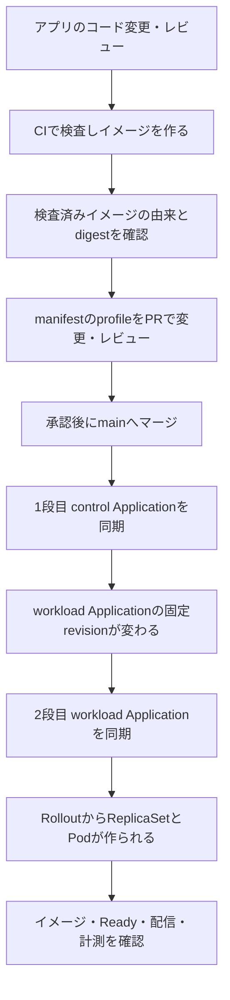

# 変更からリリースまでの追跡ガイド

コードの変更が Git に入ったことと、利用者へ新しい版が配信されていることは別の確認です。ここでは Account の実例を使い、途中で照合する値と、その値が証明する範囲を説明します。

## どの repo を変更するか

| repo | 変更するもの | 最初に見る場所 |
| --- | --- | --- |
| backend-app | Account / Order などの API、DB を扱う処理、テスト、アプリのイメージ。 | [README](https://github.com/syuhei0519/backend-app/blob/527b9bccf4ae56244d134ae384564ec1cccea815/README.md) と CI。 |
| frontend-app | 利用者向け画面、API 呼び出し、画面のテスト、画面用イメージ。 | [README](https://github.com/syuhei0519/frontend-app/blob/bf098a8f8c7a240b079880cf9de4725170dd5a78/README.md)。Backstage のリリース画面とは別です。 |
| application-manifest | アプリの Chart、Account の image / 配備方式の profile、Backstage のリリース処理。 | [Account の定義](https://github.com/syuhei0519/application-manifest/tree/573b0a6712693e03807659da660cce2fcacff527/learning/account-release)。 |
| platform-gitops | 共有基盤、親子 Application、監視・権限の宣言、現在の配備契約。 | [構成案内](../../README.md)、[所有する設定の境界](../../learning/existing-kind/CURRENT-OWNERSHIP.md)。 |

イメージを変えるためだけに共有基盤を変更する必要はありません。逆に、計測基盤の不具合をアプリの成功条件を緩めて回避しないでください。

## 全体の流れ



この図は通常の手順です。**マージ、同期、配備は状態変更**です。今回の整理用 Draft PR はマージ保留であり、図の操作を実施したという意味ではありません。

## SHA と digest を取り違えない

| 値 | 意味 | 確認場所と注意 |
| --- | --- | --- |
| ソース commit SHA | アプリのコード一式を特定する Git の値。 | アプリ repo と CI の `head_sha`。manifest repo の SHA とは別です。 |
| OCI image digest | 配備するイメージの内容を特定する値。 | 検査結果、image catalog、profile の `image`。タグ名だけでは内容を固定できません。 |
| artifact / archive の digest | CI の ZIP や保存された archive の内容を特定する値。 | CI artifact と検査記録。image digest と比較しても一致しません。 |
| manifest commit SHA | 配備定義一式を特定する値。 | manifest PR のマージ commit。イメージのソース SHA ではありません。 |
| `spec.source.targetRevision` | Application に指定した配備定義の参照先。 | control は `main`、workload は解決済みの40桁 SHA。 |
| `status.sync.revision` | Argo が比較に使っている Git revision。 | 比較対象は適用より先に進むことがあります。これだけで適用済みとは判断しません。 |
| `status.operationState.syncResult.revision` | 最後の同期処理が対象にした revision。 | `phase: Succeeded` と、進行中の `operation` がないことを合わせて確認します。さらに Pod と配信を調べます。 |
| Pod の `image` / `imageID` | Pod が要求したイメージと、runtime が記録した実体。 | Rollout → ReplicaSet → Pod の所属を確認。imageID の形式や OCI manifest / config の関係も検査済み情報と照合します。 |

`imageRevision` はこのシステムの版識別に使う文字列です。完全な image digest の代わりに、短縮したこの値だけでイメージを照合しないでください。

## 確認済みの公開例を追う

### 1. ソースと CI を結び付ける

backend-app のソースは [`527b9bccf4ae56244d134ae384564ec1cccea815`](https://github.com/syuhei0519/backend-app/commit/527b9bccf4ae56244d134ae384564ec1cccea815) です。[CI run 40145897432](https://github.com/syuhei0519/backend-app/actions/runs/40145897432) の対象 SHA と照合できます。validate、SAST、backend / order の image 検査、ci-result は成功しています。

この run には [checked-image-1 artifact](https://github.com/syuhei0519/backend-app/actions/runs/40145897432/artifacts/12580417539) があります。一方、`publish` / `propose` は **skipped** です。現在の検証では、確認済み CI artifact を kind にロードした経路が使われています。`ghcr.io/...` という名前が profile にあっても、GHCR 公開済みという意味にはなりません。artifact 取得・kind ロード自体はこの文書作成で再実行していません。

### 2. 検査済み image と manifest PR を結び付ける

[image catalog](https://github.com/syuhei0519/application-manifest/blob/573b0a6712693e03807659da660cce2fcacff527/learning/account-release/image-catalog.existing-kind.json) に記録された対象は次の値です。

```text
source commit:
527b9bccf4ae56244d134ae384564ec1cccea815

image:
ghcr.io/syuhei0519/backend-app@sha256:746e9acb5e5a24dcd6644ab5e082f2d3dad79620ec2e00afa80aa39a7436cf9a
```

catalog の `verified` と `published` は別の項目です。この例は検査済みとして記録されていますが、`published: false` です。将来の配備では、catalog の有効性、保存期限、現在の対象に使えるかを再確認します。

[manifest PR #76](https://github.com/syuhei0519/application-manifest/pull/76/files) は `runtime-profile.yaml` の source commit、imageRevision、image をこの版へ変更しました。マージ commit は [`7c06bf18dbf476072d80b7ba71fde8077370b736`](https://github.com/syuhei0519/application-manifest/commit/7c06bf18dbf476072d80b7ba71fde8077370b736) です。これは「この配備定義が Git に入った」という公開証拠です。

その後、[PR #79](https://github.com/syuhei0519/application-manifest/pull/79/files) は同じ3項目を前版へ戻し、[`573b0a6712693e03807659da660cce2fcacff527`](https://github.com/syuhei0519/application-manifest/commit/573b0a6712693e03807659da660cce2fcacff527) にマージされています。**Git に前版が入ったことだけでは、最終復旧完了とは言えません。** 同期と runtime の確認は次の段階です。

### 3. control と workload の二段階同期を追う

| 段階 | Application | 担当 | 確認すること |
| --- | --- | --- | --- |
| 1段目 | `account-release-definition`（control） | manifest repo の `application-chart` を読み、workload Application の定義を作る。 | レビューした main の commit に一致し、同期が成功していること。 |
| 2段目 | `account-release`（workload） | 固定 SHA の `chart` と `runtime-profile.yaml` を読み、アプリの宣言を適用する。 | `targetRevision` がその SHA で、完了した `syncResult.revision` も一致すること。 |

control は `$ARGOCD_APP_REVISION` で解決した commit を workload の `targetRevision` に渡します。[Application のテンプレート](https://github.com/syuhei0519/application-manifest/blob/573b0a6712693e03807659da660cce2fcacff527/learning/account-release/application-chart/templates/application.yaml) がこの固定を行います。control が `Synced` でも、workload の適用が終わったとは限りません。

[control_adapter.py](https://github.com/syuhei0519/application-manifest/blob/573b0a6712693e03807659da660cce2fcacff527/learning/account-release/control_adapter.py) は、レビューした PR の変更範囲、現在の main、対象の実体、前回同期などを確認してから同期を要求します。Backstage は Application の `source` や `ignoreDifferences` を直接書き換えず、条件を照合して `/operation` に同期要求を書きます。**`reconcile` も release / restore の進行状況によって2段目の同期を開始するため、常に読み取り専用ではありません。**

この教材では PR #76 / #79 の実際の適用済み revision を、新たな live 読み取りで確認していません。上記の commit を現在の適用済み revision と断定せず、対象時刻の Argo 記録で確かめます。

### 4. Pod と利用者への配信まで追う

読み取り確認では、同じ対象・時間帯の次の情報を結び付けます。

1. workload Application の完了した同期 revision と、読み込んだ profile の image。
2. Rollout の generation と observedGeneration、要求 image、配備方式、停止理由。
3. Rollout が所有する ReplicaSet と、その ReplicaSet が所有する Pod。Pod の image / imageID、Ready、終了や再作成の有無。
4. Istio の経路と subset、同じ観測窓の利用者リクエストと Envoy の記録、エラー率と遅延。

設定した weight や Pod 数だけでは実際の配信比率を証明できません。Argo の `Healthy` 表示だけでも利用者への成功を証明できません。[検証シナリオ](verification-scenarios.md) の観測点をそろえます。

## 通常経路を保つための注意

Canary の配信 weight と subset の Pod hash は Rollouts が更新し、Git はその親となる構造と固定 revision を持ちます。通常同期では、限定した ignore pointers と `RespectIgnoreDifferences=true` を守ります。Rolling → Canary のモード切替には、旧 image のまま段階を分ける専用処理があります。承認済み `activate-mode` の条件付き同期例外を、通常更新全般へ広げてはいけません。

新しい main が入った、対象の generation が変わった、別の同期が進行中だった場合は、古い要求をそのまま押し通さず差分を再確認します。手動の `kubectl apply` / `set image` / 通常の `rollout restart` で辻褄を合わせる経路は使いません。例外と復旧の入口は [障害対応ガイド](incident-recovery.md) を参照してください。
